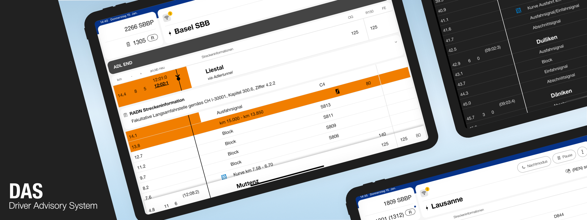

# Driver Advisory System

The Driver Advisory System (DAS) shows engine drivers all required and supporting information for safe train operation.

This repository covers the onboard part of the driver advisory system as specified in the normative context - see [Normative Scope](#normative-scope) below. The system integrates a wide range of data sources to present ideal driving profiles for each journey.

The onboard system developed within this repository is initially dedicated to railway undertakings operating within Switzerland and its border regions.

## Structure

This is a monorepository with the following applications.

### DAS-Client

[das_client](das_client/README.md) is the tablet app for Android and iOS that shows train drivers the journey data they need while driving.

### DAS-Backend

[das_backend](das_backend/README.md) is a server application that gives the DAS-Client data SFERA does not cover, such as additional cargo data, and serves the configuration and master data that administrators maintain in the DAS Admin application.

### DAS Admin

[das_admin_tool](das_admin_tool/README.md) is a web app in which administrators maintain configuration and master data, such as settings per railway undertaking.

### Test and demo tools

#### SFERA-Mock

[sfera_mock](sfera_mock/README.md) is a test and demo server that imitates TMS-VAD, the infrastructure manager's DAS-TS, and answers SFERA requests from the DAS-Client and DAS-Playground over MQTT.

#### DAS-Playground

[das_playground](das_playground/README.md) is a test and debug web app that shows the SFERA messages in the SFERA-Mock queues and sends messages to it.
 
## Normative scope

This project covers mainly the **DAS On-Board** (aka **DAS**, **DAS OB**) railway undertaking (RU)
component (see [mobile App](#Mobile-App)) according
to [UIC IRS 90940:Ed3](https://uic.org/com/enews/article/3rd-edition-of-the-sfera-protocol-available-now-including-all-on-board-devices),
also
see [high-level system architecture](./docs/content/architecture/05_building_block_view/01_whitebox_view.md).
SFERA Protocol is used for some international compatibility, but may also contain country
specific extensions (NSPs).

Out of Scope:

* The Traffic Management System **IM DAS-TS** (aka IM DAS-Trackside) is not part of this project.
* Operating aspects to national data-sources involved (for e.g. the Swiss IM DAS-TS instance
  TMS-VAD).

## Getting-Started

Please refer to the README files in the respective modules for detailed instructions.

## License

This project is licensed under [GPL v3.0](LICENSE).

## Contributing

This repository includes a [CONTRIBUTING.md](CONTRIBUTING.md) file that outlines how to contribute
to the project, including how to submit bug reports, feature requests, and pull requests.

## Coding Standards

This repository includes a [CODING_STANDARDS.md](CODING_STANDARDS.md) file that outlines the coding
standards that you should follow when contributing to the project.

## Code of Conduct

To ensure that your project is a welcoming and inclusive environment for all contributors, you
should establish a good [CODE_OF_CONDUCT.md](CODE_OF_CONDUCT.md)
